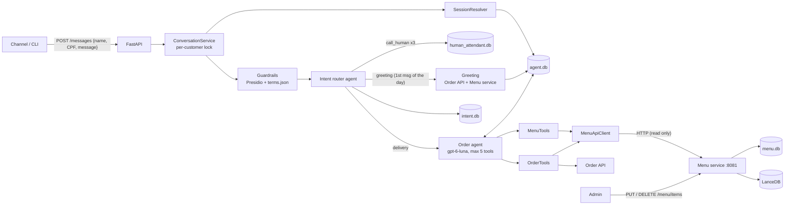

# Beauty Pizza - Delivery Agent - IA Bella

An autonomous ordering attendant for the "Beauty Pizza" pizzeria (GenAI technical case). It chats with customers in
Brazilian Portuguese. It presents the menu, answers questions about flavors, ingredients and prices, builds multi-item orders,
manages the delivery address, and confirms the order through the **Order API**.

| | |
|---|---|
| Agent framework | [Agno](https://docs.agno.com): order agent + two toolkits, plus an intent-router and a reply-rewriter agent |
| Model | `gpt-6-luna` via `OpenAIResponses` (configurable) |
| Conversation memory | SQLite (`agno.db.sqlite.SqliteDb`). To browse `data/*.db` visually, install the VS Code extension [SQLite](https://marketplace.visualstudio.com/items?itemName=alexcvzz.vscode-sqlite) (`alexcvzz.vscode-sqlite`) |
| Menu service | Separate FastAPI process that owns the menu: SQLite seeded from `knowledge_base/knowledge_base.sql`, admin add/edit/delete endpoints. `data/menu.db` opens with the same SQLite extension |
| Vector DB (differentiator) | LanceDB + OpenAI `text-embedding-3-small`, inside the Menu service: one chunk per pizza, semantic search, suggestions and typo-tolerant flavors. To browse `data/lancedb` visually, install the VS Code extension [LanceDB Studio](https://marketplace.visualstudio.com/items?itemName=sisconsavior.lancedb-studio) (`sisconsavior.lancedb-studio`) |
| HTTP API | Agent: FastAPI (`POST /messages`, `GET /health`). Menu: see [menu-service-api.md](specs/002-menu-service/contracts/menu-service-api.md) |
| Guardrails | Presidio PII masking (CPF, cards), JSON term lists (injection, profanity, competitors), intent router (with a static greeting for the first message of the day), bounded tool loop, rewrite on failure |
| Tooling | `uv`, `ruff`, `pytest`, `respx` |

The project was built spec-first (Spec-Driven Development). See [`specs/`](specs/), starting with the
[constitution](specs/constitution.md), the [feature spec](specs/001-pizza-ordering-agent/spec.md) and the
[flowchart review](specs/001-pizza-ordering-agent/flowchart-review.md). The Menu service split is specified in
[specs/002-menu-service](specs/002-menu-service/spec.md), the guardrails in [specs/003-guardrails](specs/003-guardrails/spec.md), and the greeting intent with the intent log
in [specs/004-greeting](specs/004-greeting/spec.md), the holiday mentions in
[specs/005-special-dates](specs/005-special-dates/spec.md), the Langfuse tracing in
[specs/006-langfuse-tracing](specs/006-langfuse-tracing/spec.md), and the short replies and the history limits in
[specs/007-short-replies](specs/007-short-replies/spec.md).

## Quick start

Prerequisites: Python 3.13, [uv](https://docs.astral.sh/uv/), an OpenAI API key and the
[Order API](https://github.com/gbtech-oss/candidates-case-order-api) running locally:

```bash
# in the candidates-case-order-api folder
poetry install && poetry run python manage.py migrate && poetry run python manage.py runserver   # :8000
```

Then, in this folder:

```bash
uv sync
cp .env.example .env          # set OPENAI_API_KEY
uv run delivery-agent         # single command: starts the Menu service (:8081), then serves the agent on :8080
```

Interactive API docs (Swagger UI), once the app is running:

| Service | Swagger UI | ReDoc |
|---|---|---|
| Delivery agent (:8080) | [http://127.0.0.1:8080/docs](http://127.0.0.1:8080/docs) | [http://127.0.0.1:8080/redoc](http://127.0.0.1:8080/redoc) |
| Menu service (:8081) | [http://127.0.0.1:8081/docs](http://127.0.0.1:8081/docs) | [http://127.0.0.1:8081/redoc](http://127.0.0.1:8081/redoc) |

Chat with the agent from another terminal. The CLI simulates the customer channel, which always sends name and CPF.
`123456*****` stands for a CPF: replace it with a valid one (11 digits with valid check digits, or the API answers 422).
To test the project, generate random valid CPFs at [geradordecpf.org](https://www.geradordecpf.org/) instead of using
real ones.

```bash
uv run python scripts/chat_cli.py --name "Thiago Santana" --cpf "123456*****"
```

Or call the API directly:

```bash
curl -s http://127.0.0.1:8080/messages -H "Content-Type: application/json" \
  -d '{"client_name": "Thiago Santana", "client_document": "123456*****", "message": "Oi! Quais pizzas vocês têm?"}'

# optional: the customer's city adds its local holidays (São Paulo, Rio de Janeiro or Florianópolis)
curl -s http://127.0.0.1:8080/messages -H "Content-Type: application/json" \
  -d '{"client_name": "Thiago Santana", "client_document": "123456*****", "message": "Me sugere uma pizza?", "location": "Florianópolis"}'
```

Response:

```json
{
  "reply": "Olá, Thiago! ...",
  "session_id": "6f1c2a1e-...",
  "new_session": true,
  "route": "agent",
  "order": {"order_id": 12, "status": "open", "items": [...], "delivery_address": null, "total_price": "47.00"}
}
```

`uv run delivery-agent` starts the Menu service as a child process, waits for its `/health` (up to
`MENU_SERVICE_STARTUP_TIMEOUT_SECONDS`) and stops it on exit. If a Menu service is already running at
`MENU_SERVICE_BASE_URL` it is reused. To run it on its own: `uv run menu-service`. On the first start the Menu service
seeds `data/menu.db` from the SQL script and embeds one document per pizza into `data/lancedb`.

Check that everything is up:

```bash
curl -s http://127.0.0.1:8080/health
# {"status": "ok", "order_api": "ok", "menu_service": "ok", "menu_index": "ready"}
```

### Agent tools

| Toolkit | Tools |
|---|---|
| `menu_tools` (read only, via the Menu service) | `list_menu`, `get_pizza_details`, `get_price`, `search_menu`, `suggest_pizzas` |
| `order_tools` (Order API + Menu service quotes) | `get_customer_history`, `get_current_order`, `add_pizza`, `remove_item`, `repeat_last_order`, `get_delivery_address`, `confirm_delivery_address`, `set_delivery_address`, `confirm_order`, `cancel_order` |

There is no menu-change tool; a unit test asserts the agent's tool set. Full contract:
[agent-tools.md](specs/001-pizza-ordering-agent/contracts/agent-tools.md).

### Menu service API

| Endpoint | Used by | Purpose |
|---|---|---|
| `GET /menu` | agent | Orderable pizzas with their price rows and `min_price`/`max_price`, sizes, crusts |
| `GET /menu/flavors/resolve?text=` | agent | Flavor resolution: exact → fuzzy → semantic (semantic needs confirmation) |
| `GET /menu/quote?flavor=&size=&crust=` | agent | Price of a combination, or why it can't be priced (with alternatives) |
| `POST /menu/search` | agent | Semantic search (keyword fallback) over the per-pizza documents |
| `PUT /menu/items` | admin | Add or edit a row of `pizzas`, `tamanhos`, `bordas` or `precos` |
| `DELETE /menu/items` | admin | Delete a row; deleting a pizza/size/crust cascades to its `precos` |
| `GET /health` | both | `{"status": "ok", "index": "ready\|missing"}` |

Full contract with error codes: [menu-service-api.md](specs/002-menu-service/contracts/menu-service-api.md).

### Changing the menu

Menu changes go only through the Menu service: the conversational agent has no tool or code path that edits the menu.
Every write is applied to `menu.db`, and the affected pizzas are re-embedded before the transaction commits. If the
embedding fails, the change is rolled back and the API answers `503`.

```bash
# add a pizza (no "id" = create; with "id" = partial edit). Field names are the table's columns.
curl -s -X PUT http://127.0.0.1:8081/menu/items -H "Content-Type: application/json" \
  -d '{"table": "pizzas", "fields": {"sabor": "Portuguesa", "descricao": "Clássica.", "ingredientes": "Presunto, ovo, cebola."}}'

# add/edit a price: pizza_id, tamanho_id and borda_id must exist, otherwise 422 reference_not_found
curl -s -X PUT http://127.0.0.1:8081/menu/items -H "Content-Type: application/json" \
  -d '{"table": "precos", "fields": {"pizza_id": 7, "tamanho_id": 3, "borda_id": 1, "preco": "52.00"}}'

# delete a crust: its prices are deleted too, and the pizzas that used it are re-embedded
curl -s -X DELETE http://127.0.0.1:8081/menu/items -H "Content-Type: application/json" \
  -d '{"table": "bordas", "id": 2}'
```

When `MENU_ADMIN_TOKEN` is set, `PUT`/`DELETE` require the `X-Admin-Token` header. `menu.db` is seeded from the SQL
script only when it does not exist, so edits survive restarts (delete `data/menu.db` to start over from the script).

## Guardrails

Every message goes through a guardrail pipeline around the order agent ([specs/003-guardrails](specs/003-guardrails/spec.md),
[specs/004-greeting](specs/004-greeting/spec.md)):

```
message → pre-filter (mask CPF/cards + injection/hard blocklist)
        → router (delivery | not_delivery | call_human | greeting, told whether it's the first message of the day)
        → order agent (max 5 tool calls) → output check (profanity, competitors, undesired terms) → reply
```

| Step | What it does | `route` |
|---|---|---|
| PII masking | [Presidio](https://microsoft.github.io/presidio/) masks CPFs (check digits validated) and card numbers (Luhn) as `[CPF removido]` / `[cartão removido]`. Only the masked text reaches models, logs and tickets. The reply then ends with a security notice | — |
| Input blocklist | Matches from `prompt_injection` or `input_hard_block` get a static reply, and no model is called. Curse words are **not** blocked on input | `blocked` |
| Router | A deterministic state check first: short answers like "sim" or "2" in an active flow mean `delivery`. Otherwise a small classification agent (`ROUTER_MODEL_ID`) decides. Errors fail open to `delivery` | — |
| Greeting | Only for the customer's **first message of the day** (looked up in `data/intent.db`) when it is just a greeting or a bare yes/no ("Oi", "Bom dia", "Tudo bem?", "Sim"). A message that mentions an item ("Quais são as opções?") is `delivery`, and so is a greeting later in the day. The reply is built in code, without the order agent: a **new** customer gets 3 random flavors from the Menu service; a **returning** customer gets the last order (items and total, from the Order API) and "Quer repetir esse pedido?". On "sim", the order agent repeats it. If the customer already has an order today, the order agent answers instead | `greeting` |
| Off-topic | `not_delivery` gets a static reply ("Só atendo pedidos da Beauty Pizza…") | `not_delivery` |
| Human attendant | Each `call_human` increments `human_requests`. Below 3, the agent offers to help. On the 3rd, a ticket goes to `data/human_attendant.db` (one per session) and the reply is static | `human_handoff` |
| Order agent | Bounded tool loop: `tool_call_limit=AGENT_TOOL_CALL_LIMIT` (5) | `agent` |
| Output check | The profanity, competitors and undesired-terms checks run concurrently. A failing reply is rewritten once by a tool-less agent with a critique. If it still fails, the customer is asked to rephrase. The stored history is updated to what was actually sent | `agent` |

**Static replies are part of the conversation.** Every reply sent without the order agent (greeting, off-topic,
handoff, blocked) is stored in `agent.db` as a normal turn (customer message + reply, run metadata
`static_route`), so the order agent sees it on the next message and the session stays active. A blocked message is
stored as `[mensagem bloqueada]`, so the injection text never enters the agent's context.

The term lists live in [terms.json](src/delivery_agent/guardrails/terms.json) (override the path with
`GUARDRAIL_TERMS_PATH`). Each category is a list of plain strings. Matching ignores case, accents and punctuation,
and only matches whole words, so `cu` doesn't match "cuidado". A multi-word term like `pizza hut` matches across any
spacing. The file is validated at startup.

Intent log: one row per message (redacted text, intent, how it was decided, route, first message of the day,
customer type, PII types found, latency):

```bash
sqlite3 data/intent.db "select created_at, user_id, session_id, intent, method, route, first_message_of_day, message from intent_log"
```

Human attendant tickets:

```bash
sqlite3 data/human_attendant.db "select created_at, client_name, order_id, request_count, last_message from handoff_requests"
```

## Special dates

The first reply of the **order agent** in a session can tie its pizza suggestion to a holiday or commemorative
date of the next 10 days, in a creative way ("Natal chegando… que tal uma pizza para a ceia em família?")
([specs/005-special-dates](specs/005-special-dates/spec.md)).

- The dates live in [special_dates.json](src/delivery_agent/domain/special_dates.json): `datas_fixas_nacionais`,
  `datas_moveis` (one date per year, 2026–2031) and `feriados_cidades` (`Sao_Paulo`, `Rio_de_Janeiro`,
  `Florianopolis`). The file is validated at startup.
- Without `location` (or with a blank or unknown one), only the national dates are used. With `location`, the
  city's dates are added. Matching ignores case and accents, and accepts aliases: `SP`, `Rio`, `RJ`, `Floripa`,
  `Rio de Janeiro - RJ`.
- The window (`SPECIAL_DATES_WINDOW_DAYS`, 10) is inclusive: a date exactly 10 days away counts, today counts as 0.
- The dates are computed in code and passed in `session_state.upcoming_dates` only for the first agent run of the
  session; later runs get an empty list, so the agent mentions the date once. Static replies (like the greeting)
  don't use them. The agent never promises discounts because of a date.

## Short replies and history size

These rules come from [specs/007-short-replies](specs/007-short-replies/spec.md):

- **Short replies.** The agent answers in a few short sentences. Only the order review and the options of a flavor
  the customer asked about can be longer.
- **The menu in one sentence.** `list_menu` returns a summary, never the full menu: the flavor names, the starting
  price of each size and the crusts. The agent presents it as "Temos pizzas de Margherita e Pepperoni, entre outros,
  nos tamanhos pequeno a partir de R$ 25,00, médio a partir de R$ 35,00 e grande a partir de R$ 45,00." The two
  flavors are the `suggest_pizzas` picks. A question about one flavor gets all of its options (`get_pizza_details`).
- **Response chaining kept, for cost.** For `gpt-5*`/`gpt-6*` models, Agno chains each request to the previous OpenAI
  response, and OpenAI serves about 91% of the conversation from its cache. The agent is built with
  `max_tool_calls_from_history=AGENT_MAX_TOOL_CALLS_FROM_HISTORY` (3), but this limit and `NUM_HISTORY_RUNS` only
  apply when Agno replays the context, and chaining skips that replay. Replay was measured: 19% fewer input tokens,
  but 64% more cost, because the time and session state in the system prompt change on every run and reset the
  cache.
- **Measured.** In a live 6-message conversation with chaining, the new instructions and the summary `list_menu`
  cut input tokens 14% and output tokens 35%. The estimated cost fell 23%, from $0.0022 to $0.0017, and the menu
  reply went from 1,718 characters to one sentence. See [plan.md](specs/007-short-replies/plan.md#live-measurement).

## Example conversation

```
Cliente: Oi
Agente:  Olá, Thiago, tudo bem? Somos a Beauty Pizza e temos diversos sabores como Calabresa, Portuguesa e Quatro
         Queijos e muito mais! Você pode consultar e fazer sua escolha aqui pelo chat 🍕
Cliente: Quero uma calabreza grande com borda de cheddar e duas margheritas médias
Agente:  Thiago, adicionei 1 Calabresa grande com borda recheada com Cheddar e 2 Margheritas médias tradicionais.
         O total atual é R$ 120,00. Deseja mais alguma coisa?
Cliente: Só isso
Agente:  Thiago, ainda não tenho um endereço de entrega cadastrado. Qual é a rua e o número? ...
Cliente: Rua das Acácias, 45, sem complemento
Agente:  Confira seu pedido: ... Entrega: Rua das Acácias, 45. Total: R$ 120,00. Está tudo certo?
Cliente: Sim
Agente:  Pedido confirmado, Thiago! Número do pedido: 5. Total: R$ 120,00.
```

## Architecture



- **One agent, flow in the instructions, invariants in the tools.** The designed flowchart's 🟦 customer-interaction
  nodes are agent turns. Its 🟨 Order API/menu nodes are tools. Customers jump between steps, so the flow guides the agent
  rather than being a rigid state machine. The rules that matter are enforced in code. For example, `confirm_order`
  refuses an order without items or an address.
- **The menu is a separate service.** The agent process never opens `menu.db` or LanceDB. Its tools call the Menu
  service API (menu, flavor resolution, quotes, semantic search), and the query embedding happens inside the service.
- **The LLM never decides prices, totals or identity.** `add_pizza` takes flavor/size/crust/quantity and gets the
  price from the Menu service. Totals come from the Order API. The customer's name and CPF are injected into tools via
  `run_context.dependencies` and are not visible to the model as tool arguments.
- **Sessions** are keyed by CPF (`user_id`). A session is active while its last activity in `agent.db` is within
  `SESSION_TIMEOUT_MINUTES`. The Order API `updated_at` is not used: it is not refreshed when items or addresses change.
- **Address step is tool-first.** When the customer finishes choosing items, `get_delivery_address` reads the current
  order, then the customer's previous orders. The agent asks "Podemos entregar em X?" only if an address was found.
  Otherwise it asks for one.
- **Embeddings** (one chunk per pizza, with `min_price`/`max_price` in the metadata) power `search_menu` ("tem alguma
  sem carne?"), `suggest_pizzas` (relevance-based, personalized by order history, never random) and the semantic fallback when resolving flavor names. Exact and fuzzy (`rapidfuzz`)
  matching come first. Semantic-only matches are confirmed with the customer.

- **Menu writes are consistent with the index.** A write runs in one SQLite transaction. The affected pizzas are
  re-embedded (LanceDB upsert keyed by `pizza-{id}`) before the commit, and the in-memory snapshot used for reads is
  swapped atomically afterwards. At startup the index is synced with `menu.db`: changed documents are re-embedded and
  orphans removed.
- **Protocols** (`SemanticIndex`, `MenuIndex`, `AgentRunner`) decouple the services from LanceDB and Agno, so the
  tests use in-memory fakes.

```
src/delivery_agent/      conversational agent (no direct menu access)
├── main.py (starts the Menu service + agent), config.py, logging_config.py, tracing.py (Langfuse)
├── api/       app.py (wiring + routes), schemas.py, service.py (guardrail pipeline)
├── agent/     factory.py, instructions.py (pt-BR), session_resolver.py, sessions.py, runner.py, state.py
├── guardrails/ terms.json, terms.py, pii.py (Presidio), filters.py, router.py, rewriter.py, handoff_store.py,
            greeting.py (static greeting), intent_store.py (intent log)
├── tools/     menu_tools.py, order_tools.py, results.py
├── clients/   menu_api_client.py, order_api_client.py, errors.py
└── domain/    models.py, cpf.py, formatting.py, special_dates.py + special_dates.json
src/menu_service/        Menu service (owns menu.db + LanceDB)
├── main.py, config.py, app.py (routes), schemas.py, service.py
├── store.py (transactional writes), repository.py (snapshot), resolver.py
└── vector_index.py, protocols.py, bootstrap.py, models.py, formatting.py
knowledge_base/          knowledge_base.sql (seed of menu.db)
scripts/                 chat_cli.py (customer channel simulator)
data/                    agent.db, human_attendant.db, intent.db, menu.db, lancedb/ (generated, gitignored)
tests/                   unit/ (incl. unit/menu_service/, unit/guardrails/), integration/, evals/
specs/                   constitution, 001-pizza-ordering-agent, 002-menu-service, 003-guardrails, 004-greeting,
                         005-special-dates, 006-langfuse-tracing, 007-short-replies
.claude/skills/langfuse/ Langfuse agent skill (github.com/langfuse/skills) used to build the tracing
```

## Configuration

All settings come from environment variables or `.env` (see [`.env.example`](.env.example)). The defaults below are
the values in `.env.example`. If a variable is not set at all, the code falls back to `AGENT_TOOL_CALL_LIMIT=10`,
`NUM_HISTORY_RUNS=10` and `SPECIAL_DATES_WINDOW_DAYS=7`.

| Variable | Default | Description |
|---|---|---|
| `OPENAI_API_KEY` | — | Required for the model (agent) and embeddings (Menu service) |
| `MODEL_ID` | `gpt-6-luna` | Chat model |
| `ROUTER_MODEL_ID` | `MODEL_ID` | Model of the intent router and the reply rewriter |
| `AGENT_TOOL_CALL_LIMIT` | `5` | Max tool calls of the order agent per message |
| `ORDER_API_BASE_URL` | `http://localhost:8000/api` | Order API |
| `ORDER_API_TIMEOUT_SECONDS` | `5` | Order API request timeout |
| `MENU_SERVICE_BASE_URL` | `http://127.0.0.1:8081` | Menu service, as seen by the agent |
| `MENU_SERVICE_TIMEOUT_SECONDS` | `5` | Menu service request timeout |
| `MENU_SERVICE_AUTOSTART` | `true` | `uv run delivery-agent` starts the Menu service when it isn't running |
| `MENU_SERVICE_STARTUP_TIMEOUT_SECONDS` | `60` | How long the agent waits for the Menu service `/health` at startup |
| `MENU_SERVICE_HOST` / `MENU_SERVICE_PORT` | `127.0.0.1` / `8081` | Menu service bind address (keep in step with the URL) |
| `MENU_ADMIN_TOKEN` | — | When set, menu writes require `X-Admin-Token` |
| `EMBEDDING_MODEL_ID` | `text-embedding-3-small` | Embedding model (Menu service) |
| `SEMANTIC_MAX_DISTANCE` | `0.75` | Max vector distance for a semantic-only flavor match to be proposed |
| `KB_SQL_PATH` | `knowledge_base/knowledge_base.sql` | Seed script of `menu.db` (Menu service) |
| `MENU_DB_PATH` / `VECTOR_DB_PATH` | `data/menu.db` / `data/lancedb` | Menu database and vector index (Menu service) |
| `SESSION_TIMEOUT_MINUTES` | `15` | Active-session window (minutes since the last message) |
| `NUM_HISTORY_RUNS` | `5` | Previous runs of the session sent to the model |
| `AGENT_MAX_TOOL_CALLS_FROM_HISTORY` | `3` | Tool calls (with results) kept from those runs. Like `NUM_HISTORY_RUNS`, applies only without response chaining (see 007) |
| `TIMEZONE` | `America/Sao_Paulo` | Defines "today" for `delivery_date` |
| `AGENT_DB_PATH` | `data/agent.db` | Conversation memory (gitignored) |
| `HUMAN_HANDOFF_THRESHOLD` | `3` | Human-attendant requests per session before a ticket is created |
| `HUMAN_ATTENDANT_DB_PATH` | `data/human_attendant.db` | Human attendant tickets |
| `INTENT_DB_PATH` | `data/intent.db` | Intent log, one row per message (also tells the first message of the day) |
| `SPECIAL_DATES_PATH` | packaged `special_dates.json` | Holidays and commemorative dates |
| `SPECIAL_DATES_WINDOW_DAYS` | `10` | How many days ahead a date is mentioned (inclusive) |
| `GUARDRAIL_TERMS_PATH` | packaged `terms.json` | Guardrail term lists |
| `HOST` / `PORT` | `127.0.0.1` / `8080` | This API |
| `LOG_LEVEL` | `INFO` | `DEBUG` traces every step of each conversation (see below) |
| `LOG_COLOR` | `auto` | Colored log lines on a terminal (`auto` honors `NO_COLOR` and stays plain when piped); `always` or `never` |
| `LANGFUSE_TRACING_ENABLED` | `true` | Langfuse tracing switch: `false` turns it off. It also stays off while either key is empty |
| `LANGFUSE_PUBLIC_KEY` / `LANGFUSE_SECRET_KEY` | — | Langfuse project keys (Settings → API Keys) |
| `LANGFUSE_BASE_URL` | `https://us.cloud.langfuse.com` | US cloud; `https://cloud.langfuse.com` for EU, or a self-hosted URL |
| `LANGFUSE_TRACING_ENVIRONMENT` | `development` | Separates test traces from production ones |
| `LANGFUSE_SAMPLE_RATE` | `1.0` | Share of messages traced |

Without `OPENAI_API_KEY` for embeddings, or if the index sync fails, the Menu service still works: semantic search falls
back to keyword matching. If the Menu service is down, the menu and pricing tools answer `menu_unavailable` and the agent
apologizes instead of guessing.

### Debug logs

On a terminal the log lines are colored (`LOG_COLOR=auto`): each incoming `POST /messages` is a **bold cyan**
line (`request POST /messages customer=***.***.*XX-XX chars=11 location=-`), so requests are easy to spot. Each
pipeline step then logs an **orange** line when it starts: `step=filter-input`, `step=classify-intent`,
`step=greet-customer`, `step=register-handoff`, `step=order-agent`, `step=check-output` and `step=rewrite-reply`. INFO
shows a green level name, WARNING lines are yellow, ERROR lines red, and DEBUG lines are dimmed. Piped or
redirected output stays plain `key=value`.

`LOG_LEVEL=DEBUG uv run delivery-agent` turns on Agno's native debug mode (`Agent(debug_mode=True)`). Each message then
produces a full trace:

- session resolution: resumed, expired or new (`delivery_agent.agent.session_resolver`);
- `Agent Run Start`, the tools registered for the run, then every message sent to the model (system prompt with the
  `<session_state>`, history and the customer's message);
- each model call with its tool calls (name and arguments) and token/latency metrics;
- `Running: add_pizza(flavor=..., ...)` followed by the tool result exactly as the model receives it;
- Order API calls (method, path, status, latency);
- the final reply, then the session and run saved to `agent.db`, and `Agent Run End`.

Every line carries `session=<session_id>`, so concurrent conversations can be filtered apart, and anything shaped like a
CPF is masked (`***.***.*XX-XX`), including the `current_user_id` Agno puts in the prompt. The Menu service logs in
the same `key=value` format with `service=menu` (it shares `LOG_LEVEL`). Verbose HTTP-level loggers (`httpx`,
`httpcore`, `openai`, `sqlalchemy`, `lancedb`, ...) stay at `WARNING` in both processes. Debug logs include customer
messages and addresses: use them in development only.

On Windows, asyncio's Proactor loop logs a harmless `ConnectionResetError: [WinError 10054]` traceback from
`_call_connection_lost` when a server has already reset an idle keep-alive connection. Nothing fails (the HTTP client
opens a new connection), so both processes filter that one record out.

### Tracing (Langfuse)

With `LANGFUSE_PUBLIC_KEY` and `LANGFUSE_SECRET_KEY` set, every customer message becomes one Langfuse trace
([specs/006-langfuse-tracing](specs/006-langfuse-tracing/spec.md)). To turn tracing off without removing the keys,
set `LANGFUSE_TRACING_ENABLED=false` in `.env`. The startup log says which mode is active
(`tracing on: Langfuse base_url=...` or `tracing off (...)`).

```
handle-message                 in: the redacted message · out: the reply · tag: the route
├─ filter-input (guardrail)     PII found, blocked or not
├─ classify-intent (chain)      intent, method, reason   └─ Intent_Router.arun → generation
├─ greet-customer / register-handoff                     (static routes)
├─ Beauty_Pizza_Attendant.arun (agent)                   generations (model, tokens, cost) and tools
├─ check-output (guardrail)     WARNING when the reply has a forbidden term
└─ rewrite-reply (chain)        only after a violation   └─ Reply_Rewriter.arun → generation
```

- **Sessions:** the Agno `session_id` groups a conversation's traces.
- **Filtering:** traces can be filtered by route (tag) or by `intent`, `method`, `flow_step` and
  `first_message_of_day` (metadata).
- **Version:** each trace carries `prompts-<hash>`, a hash of the agent prompts, so a prompt change shows up as a new
  version.
- **Agno spans:** these come from `openinference-instrumentation-agno`.
- **Privacy:** CPFs are masked at export, with the same rule as the logs. This includes the `current_user_id` that
  Agno puts in the prompt. The user id is a keyed pseudonym (`customer-<hmac>`), never the CPF. Customer names and
  addresses from tool results are not masked, the same as the debug logs.
- **Tests:** they never send traces, because `tests/conftest.py` sets `LANGFUSE_TRACING_ENABLED=false` unless it is
  already exported.

## Tests

```bash
uv run pytest                      # unit tests, no network/LLM (fake Order API, in-process Menu service, respx)
uv run pytest -m integration       # tools + real Order API (ORDER_API_BASE_URL)
uv run pytest -m evals             # golden pt-BR conversations: live model + Order API + Menu service
uv run ruff check . && uv run ruff format --check .
```

The evals assert on outcomes (Order API state, session state), not on wording. They cover: a new customer with
several items and a new address, a returning customer repeating the last order and keeping the address, menu questions
plus an invalid size/crust combination, a prompt-injection attempt to change the price, and the guardrails
(an off-topic question, a human handoff on the 3rd request, a card number never echoed), and the greeting
(3 menu flavors for a new customer, a later "Oi" going to the agent, a bare "Sim" as a greeting, a first message
with an item going to the agent), and the first agent reply mentioning a date of the next 10 days (skipped when there
is none). The evals are skipped when
the Menu service is not reachable at `MENU_SERVICE_BASE_URL`.

Project conventions: every function, tests included, has a one-line docstring (enforced by
`tests/unit/test_docstrings.py`). Code is in English; customer-facing text is pt-BR.

## Order API behaviors handled by the agent

| Order API behavior | How the agent handles it |
|---|---|
| One order per customer per day (`unique_together`) | Today's order is adopted and modified, never duplicated. Parallel tool calls are serialized per customer. |
| No order status | "Pedido feito" is tracked in the agent session state. Any later change requires re-confirmation. |
| `updated_at` not refreshed by add-items / update-address | Sessions use the agent's own storage |
| Client-supplied `unit_price` | Prices always come from the Menu service quote, never from the model |
| `update-address` only overwrites the keys sent | All four address keys are always sent |
| No delete-order endpoint | Cancel removes all items |
| Item delete answers `204` with a body (breaks keep-alive reuse) | Deletes are sent with `Connection: close` |
