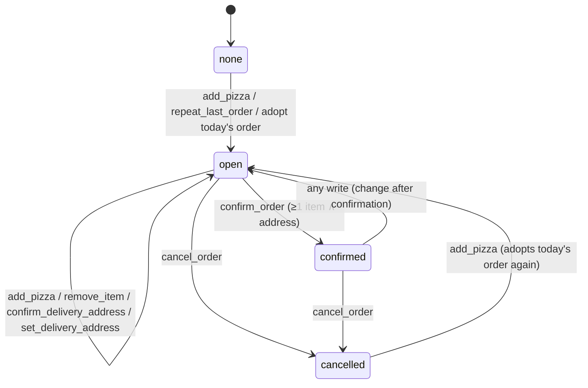

# Data Model: Beauty Pizza Ordering Agent

> **Amended by [002-menu-service](../002-menu-service/spec.md).** The menu (knowledge base and vector index) now lives in a separate
> Menu service. The agent reads it only through the [Menu service API](../002-menu-service/contracts/menu-service-api.md), and every agent tool that
> touches the menu calls that API. Where this document describes the agent reading `menu.db`/LanceDB directly, the
> 002 documents take precedence.

## 1. Knowledge Base (SQLite, read-only at runtime)

Created from `knowledge_base/knowledge_base.sql` into `MENU_DB_PATH` by `menu/bootstrap.py`. Table and column names
are kept as provided (pt-BR). They are data owned by the case, not by this project.

```mermaid
erDiagram
    pizzas ||--o{ precos : priced
    tamanhos ||--o{ precos : sized
    bordas ||--o{ precos : crusted
    pizzas { int id PK; text sabor; text descricao; text ingredientes }
    tamanhos { int id PK; text tamanho }
    bordas { int id PK; text tipo }
    precos { int pizza_id PK,FK; int tamanho_id PK,FK; int borda_id PK,FK; real preco }
```

Current content: 6 flavors (Margherita, Pepperoni, Quatro Queijos, Calabresa, Frango com Catupiry, Doce de Leite com
Coco), 3 sizes (Pequena, Média, Grande), 3 crusts (Tradicional, Recheada com Cheddar, Recheada com Catupiry).

**Availability rules** (derived from `precos`, never hard-coded):
- Pequena exists only with Tradicional.
- Doce de Leite com Coco exists only with Tradicional (all sizes).
- Savory flavors: Média/Grande with all 3 crusts.

The domain code must treat "a row exists in `precos`" as the only validity criterion.

## 2. Domain Models (`domain/models.py`, pydantic v2)

```python
class Pizza(BaseModel):
    id: int
    flavor: str  # pizzas.sabor
    description: str  # pizzas.descricao
    ingredients: str  # pizzas.ingredientes


class PriceEntry(BaseModel):
    pizza_id: int
    flavor: str
    size: str  # tamanhos.tamanho
    crust: str  # bordas.tipo
    price: Decimal  # precos.preco, quantized to 0.01


class PriceQuote(BaseModel):
    available: bool
    entry: PriceEntry | None
    alternatives: list[PriceEntry] = []  # valid combos for the flavor when unavailable


class FlavorMatch(BaseModel):
    pizza: Pizza | None
    score: float
    method: Literal["exact", "fuzzy", "semantic", "none"]
    needs_confirmation: bool


class CustomerContext(BaseModel):
    client_name: str
    client_document: str  # 11 digits, validated

    @property
    def first_name(self) -> str: ...


class DeliveryAddress(BaseModel):
    street_name: str = Field(min_length=1, max_length=255)
    number: str = Field(min_length=1, max_length=20)
    complement: str | None = Field(default=None, max_length=255)
    reference_point: str | None = Field(default=None, max_length=255)


class OrderItemIn(BaseModel):  # payload to the Order API
    name: str = Field(max_length=255)
    quantity: int = Field(ge=1, le=20)
    unit_price: Decimal = Field(ge=0, max_digits=10, decimal_places=2)


class OrderItem(OrderItemIn):  # from the Order API
    id: int


class Order(BaseModel):  # mirrors OrderSerializer output
    id: int
    client_name: str
    client_document: str
    delivery_date: date
    delivery_address: DeliveryAddress | None
    items: list[OrderItem]
    total_price: Decimal
    created_at: datetime
    updated_at: datetime


class ParsedItemName(BaseModel):  # result of parse_item_name()
    flavor: str
    size: str
    crust: str
```

## 3. Agent Session State (`agent/state.py`)

Stored by Agno in `agent.db` (sessions table, `session_data.session_state`). Only tools mutate it.

```python
DEFAULT_SESSION_STATE = {
    "order_id": None,  # int | None — current Order API order
    "order_status": "none",  # "none" | "open" | "confirmed" | "cancelled"
    "flow_step": "start",  # "start" | "building" | "address" | "review" | "confirmed"
    "address_set": False,  # current order has a delivery address
    "address_candidate": None,  # {"source": "current_order"|"last_order", "from_order_id": int|None,
    #  "address": DeliveryAddress dict} — set by get_delivery_address,
    #  consumed by confirm_delivery_address
    "last_order_id": None,  # int | None — most recent previous order (history)
    "previous_flavors": [],  # flavors from the order history, personalizes suggest_pizzas
    # "customer_first_name" is not a default: the service passes it on every run.
    "repeat_offered": False,  # avoid offering repeat twice
    "upsell_offered": False,  # at most one upsell per order
    "confirmed_at": None,  # ISO datetime | None
    "order_snapshot": None,  # OrderSnapshot dict, refreshed after each write
}
```

State transitions (`order_status`):



## 4. Agent Storage (Agno `SqliteDb`, `agent.db`)

Managed entirely by Agno. Tables used: sessions (history, session state, `user_id`, `created_at`, `updated_at`) and runs.
Keys:
- `user_id` = normalized CPF (11 digits)
- `session_id` = UUID4, created by `SessionResolver` when no active session exists

## 5. Vector Index (LanceDB, `data/lancedb`, table `menu`)

| Field     | Content                                                                                 |
|-----------|-----------------------------------------------------------------------------------------|
| content   | `"{sabor}. {descricao} Ingredientes: {ingredientes}. Tamanhos: {sizes}. Bordas: {crusts}. A partir de R$ {min_price}."` |
| embedding | `text-embedding-3-small` vector                                                         |
| meta      | `{"pizza_id": int, "flavor": str, "min_price": float, "max_price": float}`              |
| id        | `pizza-{id}` (also the LanceDB content hash: one chunk per pizza)                       |

Since 002, the index is kept in step with `menu.db` by the Menu service: re-embedded on every menu write and synced at
startup. The `menu_index.hash` file is no longer used.

## 6. HTTP DTOs

See [contracts/delivery-agent-api.md](contracts/delivery-agent-api.md). `OrderSnapshot` (also stored in session state):

```python
class OrderSnapshotItem(BaseModel):
    item_id: int
    name: str
    quantity: int
    unit_price: Decimal
    subtotal: Decimal


class OrderSnapshot(BaseModel):
    order_id: int
    status: Literal["open", "confirmed", "cancelled"]
    delivery_date: date
    items: list[OrderSnapshotItem]
    delivery_address: DeliveryAddress | None
    total_price: Decimal
```
