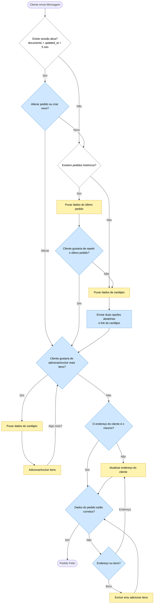
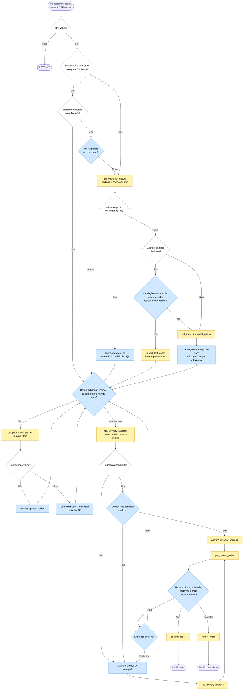

# Flowchart Review — `case_info/delivery-flowchart.bpmn`

This document reviews the designed BPMN flow against the case requirements and the real behavior of the Order API,
then defines the revised flow used by this spec.

## 0. Node types (color legend)

The flowchart author uses colors to separate what the customer sees from what the system does:

| Color          | Node type                 | Meaning in this spec                                                                 |
|----------------|---------------------------|--------------------------------------------------------------------------------------|
| 🟦 Light blue  | **Customer interaction**  | The agent sends a message and waits for the customer's next message (one chat turn). |
| 🟨 Yellow      | **Tool call**             | A call to the Order API or the menu (knowledge base / vector index), exposed to the agent as a tool. |
| ⬜ White       | **System decision**       | A branch the system evaluates from data (session state or a tool result), with no question to the customer. |

The BPMN export does not include colors, so the classification below was inferred from each node's meaning. It drives
the spec: **every 🟨 node maps to a tool** in [contracts/agent-tools.md](contracts/agent-tools.md), and **every 🟦 node
maps to an agent turn** described in the agent instructions ([plan.md §3.3](plan.md)).

| BPMN node                                              | Type | Implemented by                                  |
|--------------------------------------------------------|------|-------------------------------------------------|
| Existe sessão ativa?                                   | ⬜   | `SessionResolver` (before the agent runs)       |
| Alterar pedido ou criar novo?                          | 🟦   | Agent turn                                      |
| Existem pedidos históricos?                            | ⬜   | Result of `get_customer_history`                |
| Puxar dados do último pedido                           | 🟨   | `get_customer_history`                          |
| Cliente gostaria de repetir o último pedido?           | 🟦   | Agent turn                                      |
| Puxar dados de cardápio / Puxar dados do cardápio      | 🟨   | `list_menu`, `get_pizza_details`, `get_price`, `search_menu`, `suggest_pizzas` |
| Enviar duas opções aleatórias ao cliente e link do cardápio | 🟦 | Agent turn (text menu + 2 relevant suggestions) |
| Cliente gostaria de adicionar/excluir mais itens?      | 🟦   | Agent turn ("Deseja mais alguma coisa?")        |
| Adicionar/excluir itens / Excluir e/ou adicionar itens | 🟨   | `add_pizza`, `remove_item`                      |
| O endereço do cliente é o mesmo?                       | 🟦   | Agent turn, preceded by 🟨 `get_delivery_address` |
| Atualizar endereço do cliente                          | 🟨   | `set_delivery_address` / `confirm_delivery_address` |
| Dados do pedido estão corretos?                        | 🟦   | Agent turn, preceded by 🟨 `get_current_order`  |
| Endereço ou itens?                                     | 🟦   | Agent turn                                      |
| Pedido Feito (end event)                               | —    | Reached after 🟨 `confirm_order` succeeds       |

## 1. Original flow (as designed, after fix #3)

Node labels are kept in pt-BR as drawn in the BPMN. The item loop (`T5 → G4`) was corrected in the BPMN file. See issue 3.

## 2. Verdict

**The design is a good foundation for the challenge.** It is customer-centric and already covers several behaviors that
go beyond the minimum requirements:

- Recognizing returning customers through their order history.
- A "repeat last order" shortcut, which reduces friction for loyal customers.
- Session resumption with an explicit "change or start new" decision.
- Address confirmation instead of always asking for it.
- A final review loop with a targeted correction branch (address vs. items).
- A clear separation between customer interactions (🟦) and system calls (🟨), which maps directly onto agent turns
  and agent tools.

The remaining gaps are against the mandatory requirements and the Order API's real behavior. They are listed below and
addressed in the revised flow (section 5) and in [spec.md](spec.md).

## 3. Issues

| # | Severity | Node(s) | Issue | Resolution |
|---|----------|---------|-------|------------|
| 1 | High | `Existe sessão ativa?` | Uses the Order API `updated_at` to detect an active session. In the API, `add-items` creates `Item` rows without saving the `Order`, and `update-address` on an existing address saves only the `DeliveryAddress`. So `Order.updated_at` is **not refreshed** by the most common operations. Orders are also not sessions: a chat can be active without any order. | Active session = Agno session (SQLite) for `user_id = client_document` whose last activity is within `SESSION_TIMEOUT_MINUTES` (FR-014, US-7). |
| 2 | High | `Alterar pedido ou criar novo? → Novo`, `repetir último pedido` | The Order API enforces `unique_together(client_name, client_document, delivery_date)`. A second order on the same day returns HTTP 400. Repeating an order placed today hits the same constraint. | `delivery_date` = today. If today's order exists, it is loaded and offered for modification instead of being duplicated (FR-016, EC-04). |
| 3 | ✅ Fixed | `Adicionar/excluir itens` | Originally, after adding **one** item the flow jumped straight to `O endereço é o mesmo?`, so adding multiple items was not possible. | **Fixed in the BPMN**: the edge from `Adicionar/excluir itens` now returns to `Cliente gostaria de adicionar/excluir mais itens?` ("Algo mais?"). The flow only moves on to the address when the customer says they are done (AC-3.7, AC-3.8). |
| 4 | High | (missing) | **Free-form menu Q&A** (ingredients, flavors, prices), which is mandatory requirement #2, is not represented. In practice it can happen at any 🟦 step. | Global capability, available at every customer turn, and progress is preserved (US-2, AC-2.5). |
| 5 | High | (missing) | **Total price** (mandatory requirement #3 and the API "retrieve total" requirement) is never shown. | Running total after each 🟨 item change, and a full summary with the total before confirmation (AC-3.7, AC-5.1). |
| 6 | Medium | `O endereço é o mesmo?` | It is a 🟦 question that assumes a previous address exists. New customers, and orders created without an address (the address is optional in the API), have nothing to compare against. | A 🟨 tool call **before** the question: once the customer finishes the items, `get_delivery_address` reads the current order from the Order API, falling back to the customer's most recent order. If an address is found, the agent asks whether it is still correct. If not, it asks for the address (US-4). |
| 7 | Medium | (missing) | No explicit greeting/menu presentation step (mandatory requirement #1). | Greeting by name + menu presentation at session start (US-1). |
| 8 | Medium | `Enviar duas opções aleatórias e link do cardápio` | Random suggestions are a missed opportunity, and there is no menu link (no web menu exists). | Relevance-based suggestions with embeddings + menu rendered as text (US-8, AC-1.3). |
| 9 | Medium | `Pedido Feito` | The Order API has no status field. An order exists (and is "placed") as soon as it is created, so "Pedido feito" has no API counterpart. | Confirmation tracked in the agent session state (`order_status = confirmed`) by `confirm_order`. The order is created on the first item (FR-007, AC-5.2). |
| 10 | Medium | (missing) | Error paths are absent: invalid flavor/size/crust combination (e.g. Pequena only has Tradicional crust), API failure, cancel/abandon. | Edge cases EC-01…EC-12. |
| 11 | Low | `Puxar dados do cardápio` / `Puxar dados de cardápio` | Duplicate 🟨 nodes with slightly different names. | A single `MenuTools` toolkit, callable at any step. |
| 12 | Low | `Excluir e/ou adicionar itens → Dados corretos?` | The correction branch allows a single change before returning to the review. | It reuses the same item loop ("Algo mais?") and then goes back to the review. |
| 13 | Low | Whole diagram | A rigid state machine. Customers using an LLM chat do not follow it linearly ("quero uma calabresa grande, entrega na rua X" covers 3 steps in one message). | The flow becomes **guidance** in the agent instructions (🟦 turns). Invariants are enforced by tools (🟨), e.g. `confirm_order` refuses without items + address. |

## 4. Opportunities

1. **Embeddings-based recommendations** (replaces the random options): semantic search over flavor + description +
   ingredients. For returning customers, seed the query with their previous flavors. This also covers the case's
   vector-database differentiator.
2. **Fuzzy / semantic flavor resolution**: "calabreza", "4 queijos", "frango catupiri" resolve to the right menu item.
3. **Smart upsell** with real KB prices: e.g. "Por mais R$ 3,00 a borda vira Recheada com Catupiry", or offering the
   sweet pizza as a dessert. At most once per order.
4. **One-message reorder**: "Quer repetir seu último pedido (1x Calabresa Grande Tradicional — R$ 47,00)?"
5. **Rich confirmation summary** built from the API response: per-item subtotal, address, total, order number.
6. **Conversation evals**: golden pt-BR dialogues that replay the flowchart paths and serve as acceptance tests. Each
   test asserts the expected 🟨 tool calls between 🟦 turns.
7. **Multi-intent messages**: in one turn the agent can run several 🟨 tools (add 2 pizzas + set the address).

## 5. Revised flow (adopted by this spec)

Menu questions (🟨 `get_pizza_details`, `get_price`, `search_menu`) can be answered at **any** 🟦 node. Afterwards
the agent repeats the pending question.

### 5.1 Address step in detail (tool-first)

The address is resolved **after the customer finishes choosing items** (answers "não" to "Algo mais?"):

1. 🟨 `get_delivery_address()` reads the current order from the Order API (`GET /api/orders/{id}/`):
   - If the order already has a `delivery_address` (e.g. it was copied by `repeat_last_order` or set earlier), that is
     the candidate (`source = "current_order"`).
   - Otherwise it looks up the customer's most recent previous order with an address (`GET /api/orders/filter/`)
     (`source = "last_order"`).
   - Otherwise there is no candidate (`source = "none"`).

   The candidate is stored in `session_state.address_candidate`.
2. ⬜ Candidate found?
   - 🟦 **Yes**: "Podemos entregar em *Rua das Flores, 100 - ap 12 (perto da praça)*?"
     - Customer says yes → 🟨 `confirm_delivery_address()` copies the candidate to the current order via
       `PATCH update-address` (no API call when `source = "current_order"`).
     - Customer says no → go to the "ask for address" turn.
   - 🟦 **No**: "Qual o endereço de entrega? Preciso da rua e do número; complemento e ponto de referência são
     opcionais."
3. 🟨 `set_delivery_address(...)` saves the address typed by the customer.
4. 🟨 `get_current_order()`, then the 🟦 review turn.

## 6. Node mapping (original → revised)

| Original node                                       | Type | Revised handling                                              |
|-----------------------------------------------------|------|---------------------------------------------------------------|
| Cliente envia Mensagem                              | —    | `POST /messages` with name + CPF                              |
| Existe sessão ativa? (documento + updated_at < 5m)  | ⬜   | Agno session last activity < `SESSION_TIMEOUT_MINUTES`        |
| Alterar pedido ou criar novo?                       | 🟦   | Kept. Asked only when the session order is confirmed. "Novo" respects the daily unique constraint. |
| Existem pedidos históricos?                         | ⬜   | Kept, evaluated from the `get_customer_history` result        |
| Puxar dados do último pedido                        | 🟨   | `get_customer_history`                                        |
| Cliente gostaria de repetir o último pedido?        | 🟦   | Kept. Yes → 🟨 `repeat_last_order` (re-priced)                |
| Puxar dados de cardápio (×2)                        | 🟨   | Merged into `MenuTools`, callable anytime                     |
| Enviar duas opções aleatórias e link do cardápio    | 🟦   | Text menu + 2 relevance-based suggestions (🟨 `suggest_pizzas`) |
| Cliente gostaria de adicionar/excluir mais itens?   | 🟦   | Kept as the item loop ("Algo mais?"). The loop is now fixed in the BPMN. |
| Adicionar/excluir itens / Excluir e/ou adicionar    | 🟨   | `add_pizza`, `remove_item` (+ total from the Order API)       |
| O endereço do cliente é o mesmo?                    | 🟦   | Kept, preceded by 🟨 `get_delivery_address`. Asked only when a candidate exists. |
| Atualizar endereço do cliente                       | 🟨   | `confirm_delivery_address` (reuse) / `set_delivery_address` (new) |
| Dados do pedido estão corretos?                     | 🟦   | Kept, preceded by 🟨 `get_current_order` (summary + total)    |
| Endereço ou itens?                                  | 🟦   | Kept. "Itens" returns to the item loop.                       |
| Pedido Feito                                        | —    | 🟨 `confirm_order` → session state `confirmed`                |
| (new)                                               | —    | CPF validation, today's-order check, menu Q&A anywhere, total after each change, ask-for-address turn, cancel path, error handling |
