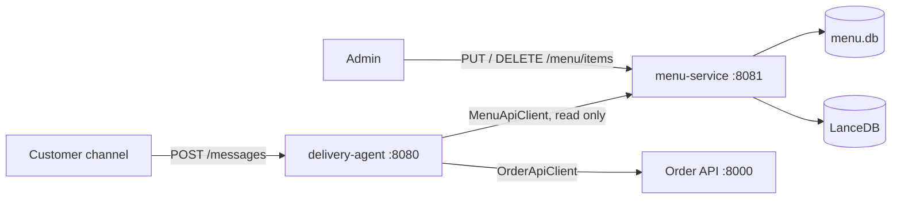

# Implementation Plan: Menu Service

| Field   | Value |
|---------|-------|
| Feature | 002-menu-service |
| Spec    | [spec.md](spec.md) |
| Status  | Implemented |

## 1. Architecture



- **Two processes, one command.** `uv run delivery-agent` (`delivery_agent/main.py`) spawns
  `python -m menu_service.main` and polls `GET /health` (up to `MENU_SERVICE_STARTUP_TIMEOUT_SECONDS`). It then serves
  the agent and terminates the child in a `finally`. A healthy service already at `MENU_SERVICE_BASE_URL` is reused.
  `MENU_SERVICE_AUTOSTART=false` disables the spawn.
- **Independence.** `src/menu_service` imports nothing from `delivery_agent`. The agent's DTOs
  (`domain/models.py`: `Menu`, `MenuPizza`, `FlavorMatch`, `MenuQuote`, `MenuSearchHit`) mirror the JSON contract.

## 2. Menu service modules (`src/menu_service/`)

| Module | Responsibility |
|---|---|
| `config.py` | `MenuSettings` (same `.env` as the agent) |
| `bootstrap.py` | Seed `menu.db` from the SQL script **only when missing** |
| `repository.py` | Immutable in-memory snapshot (`from_path`, `from_connection`), price range helpers |
| `store.py` | Transactional writes: upsert/delete per table, reference checks, `precos` cascade, affected pizza ids |
| `resolver.py` | Flavor/size/crust resolution (exact → fuzzy → semantic), restricted to current menu names |
| `protocols.py` | `SemanticIndex` (search) and `MenuIndex` (search + `sync` + `refresh` + `ready`) |
| `vector_index.py` | `MenuVectorIndex(MenuIndex)`: one document per pizza, `sync`, `refresh`, `search` |
| `service.py` | `MenuService`: reads over the current snapshot, writes under a lock with index-before-commit |
| `schemas.py` | Request/response models (discriminated unions on `table`) |
| `app.py` | FastAPI routes, error mapping, admin-token dependency, lifespan |
| `main.py` | `uv run menu-service` |

## 3. Write path

```
PUT/DELETE /menu/items
  └─ MenuService._write (threading.Lock)
       └─ store.transaction(db)            BEGIN (foreign_keys = ON)
            ├─ store.upsert/delete         validate, write, collect affected pizza ids
            ├─ MenuRepository.from_connection(conn)    sees the uncommitted change
            ├─ index.refresh(repo, affected)           embed + upsert / remove documents
            │     └─ raises → ROLLBACK → 503 index_unavailable
            └─ COMMIT
       └─ reload snapshot + resolver (one atomic tuple swap)
```

Affected pizzas:
- pizza upsert → that pizza
- price write → its pizza
- size/crust rename or delete → the pizzas with a price using it (collected before the delete)
- new size/crust → none

The snapshot is swapped as one `(repository, resolver)` tuple, so concurrent reads never mix two versions. FastAPI
runs the sync endpoints in its threadpool, so SQLite and embedding calls don't block the event loop.

## 4. Vector index

- One document per orderable pizza. `Document.id` = LanceDB `content_hash` = `pizza-{id}`. `LanceDb.upsert` replaces
  exactly that pizza's row; Agno embeds before deleting, so a failed embedding keeps the old row.
- `meta_data = {pizza_id, flavor, min_price, max_price}` (floats, JSON-serializable).
- `sync(repository)` at startup compares stored `(content, meta_data)` with the expected documents. It upserts the
  differences and deletes rows whose content hash is not expected. This migrates the 001 index (rows keyed by the SQL
  hash) automatically.
- `ready` = the table exists and holds rows (Agno creates the table on init).

## 5. Agent changes

- `clients/menu_api_client.py`: `get_menu`, `resolve_flavor`, `quote`, `search`, `health`, `ping`. It has no write
  methods. Transport errors and 5xx raise `MenuServiceUnavailableError`; other 4xx raise `MenuServiceError`.
- `MenuTools(menu_client)`: same five tools, now async. `OrderTools(order_client, menu_client)`: `_build_item` and
  `_repeat_last_order` use `quote`. Menu errors map to `menu_unavailable`.
- `domain/formatting.render_menu(menu)` renders the menu in pt-BR. The hardcoded "Pequena/doce only Tradicional" note
  became a generic line, because availability now changes at runtime.
- `/health` adds `menu_service`. `menu_index` comes from the Menu service health.
- Removed: `delivery_agent/menu/`, plus the agent settings `KB_SQL_PATH`, `MENU_DB_PATH`, `VECTOR_DB_PATH`,
  `EMBEDDING_MODEL_ID` and `SEMANTIC_MAX_DISTANCE` (they are now Menu service settings).

## 6. Configuration

| Variable | Owner | Default |
|---|---|---|
| `MENU_SERVICE_BASE_URL` | agent | `http://127.0.0.1:8081` |
| `MENU_SERVICE_TIMEOUT_SECONDS` | agent | `5` |
| `MENU_SERVICE_AUTOSTART` | agent | `true` |
| `MENU_SERVICE_STARTUP_TIMEOUT_SECONDS` | agent | `60` |
| `MENU_SERVICE_HOST` / `MENU_SERVICE_PORT` | menu | `127.0.0.1` / `8081` |
| `MENU_ADMIN_TOKEN` | menu | unset (writes open) |
| `KB_SQL_PATH`, `MENU_DB_PATH`, `VECTOR_DB_PATH` | menu | as in 001 |
| `OPENAI_API_KEY`, `EMBEDDING_MODEL_ID`, `SEMANTIC_MAX_DISTANCE` | menu (key also agent) | as in 001 |

## 7. Testing

- `tests/unit/menu_service/`: store, repository/resolver, vector index (temp LanceDB with a hashing embedder) and HTTP
  API (TestClient + `FakeIndex`, including rollback on index failure and the admin token).
- Agent tests use `FakeMenuApi` (`tests/conftest.py`), which wraps a real `MenuService` and round-trips each response
  through JSON. The tools are therefore tested against the real menu logic and the wire format, without HTTP.
- `test_menu_api_client.py` (respx) and `test_main.py` (spawn/terminate with `Popen` monkeypatched).
- `test_docstrings.py` covers `src/menu_service` automatically.
